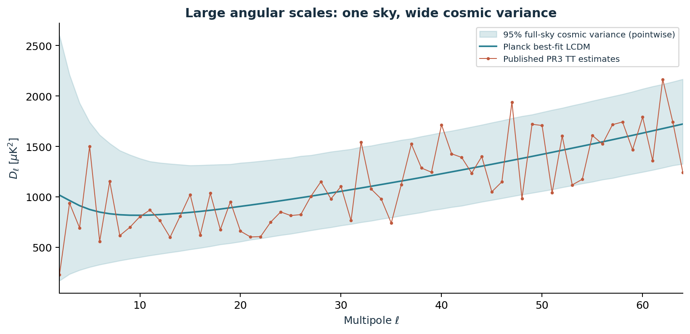

# CMB Anomaly Lab

**Five connected questions about the largest temperature patterns in the cosmic microwave background.**

Author and project owner: **[Biswajit Jana](https://github.com/Biswajit1999)**. Initial research software and report prepared with OpenAI Codex assistance. Observations belong to ESA and the Planck Collaboration.

This project downloads official **Planck 2018 (PR3)** numerical data, runs reproducible mathematical experiments, and asks how much of the large-angle anomaly story survives conditioning and explicitly counted searches. It includes a research report, equations, annotated literature, numerical results, and scientific figures.

**Status: exploratory research and reproduction, not a discovery of new physics.** The numerical probabilities use a full-sky, noise-free Gaussian reference for published spectrum estimates. This is not a reproduction of the masked-sky Planck likelihood pipeline. Spectral anomalies alone do not establish a preferred direction in space.



## Read the work

- [Research report](reports/research-report.md) and [downloadable PDF](reports/cmb-anomaly-lab.pdf)
- [Computed results](results/baseline/SUMMARY.md) and [machine-readable results](results/baseline/results.json)
- [Mathematical methods](docs/methods.md)
- [Annotated reading guide](docs/literature-review.md), including the 2026 debate on combined anomaly significance
- [Research hypotheses and next experiments](docs/research-agenda.md)
- [Data provenance](data/manifest.json) and [data interpretation](data/README.md)

## Five questions

| Question | Experiment | What this can establish |
|---|---|---|
| Is the quadrupole unusually weak? | Exact chi-square cosmic variance and Monte Carlo | Its rarity under a specified Gaussian spectrum |
| Are correlations beyond 60 degrees unusually small? | Legendre reconstruction and the S1/2 integral | A spectrum-based full-sky proxy, not the cut-sky correlation statistic |
| Is there unusually more odd than even power? | Mean even/odd D-ell ratio; cutoff scan | Local and scan-calibrated probabilities |
| Is large-scale variance unusually low? | Band-limited variance for ell 2-29 | Total large-scale power, not north/south asymmetry |
| Are these independent clues? | Conditional simulations, tail co-occurrence, calibrated minimum-p | Dependence and selection effects within a declared finite family |

## First measured results

Two independent batches contain **100,000 simulated spectra each**. These are exact draws of the full-sky Gaussian power-spectrum distribution; rendering 200,000 pixel maps would add cost without changing these phase-independent statistics.

| Diagnostic | Observed | Approximate lower-tail p |
|---|---:|---:|
| Quadrupole C2 | 236.56 microkelvin squared | 0.04699 |
| S1/2, ell 2-64 | 6767.53 microkelvin to the fourth | 0.07521 |
| Even/odd power, ell 2-29 | 0.76288 | 0.01011 |
| Variance, ell 2-29 | 2074.52 microkelvin squared | 0.10353 |

Holding the quadrupole fixed to its measured value changes the S1/2 lower-tail probability from **0.0752 to 0.4842** in this reference model. This illustrates shared dependence, not a physical explanation. The four-test minimum-p calibration gives **0.0379**. Scanning the parity cutoff gives a corrected **0.0133** for that particular scan. All declared fixed and scan tests together give **0.0301**, which is not a correction for every choice ever made in CMB research. See the results file for Monte Carlo confidence intervals.

These results do **not** contradict much smaller masked-sky probabilities in the literature: those use different estimators. A direct, matched map-and-mask experiment is the next major scientific step.

## Reproduce

Python 3.10 or later. Linux/macOS or WSL is recommended for the optional HEALPix map step. The core spectral analysis does not require healpy.

```bash
git clone https://github.com/Biswajit1999/cmb-anomaly-lab.git
cd cmb-anomaly-lab
python -m venv .venv
source .venv/bin/activate
python -m pip install -e '.[dev,report]'
python scripts/download_data.py
python -m pytest -q
OMP_NUM_THREADS=2 OPENBLAS_NUM_THREADS=2 cmb-lab
python scripts/validate_run.py
python scripts/build_report.py
```

On Windows PowerShell activate with `.venv\Scripts\Activate.ps1`, set `$env:OMP_NUM_THREADS='2'` and `$env:OPENBLAS_NUM_THREADS='2'`, then run `cmb-lab`. The environment variables only limit CPU threading.

A quick execution check uses `cmb-lab --quick` and writes to `results/quick`, leaving the baseline intact. The committed configuration is [config/analysis.json](config/analysis.json). Use `--config` and `--output` for separate experiments. Cached text inputs are checked against SHA-256 hashes before use. An exact version snapshot from the executed Linux environment is in [requirements-lock.txt](requirements-lock.txt).

The ten numerical tests pass. A further **100,000 spectra with an independent seed** reproduce all four primary marginal probabilities within 1.53 combined Monte Carlo standard deviations; see [validation.json](results/validation.json). This is a stability check, not additional observational evidence.

### Original map and simulated skies

```bash
python -m pip install -e '.[maps]'
python scripts/download_data.py --with-map
OMP_NUM_THREADS=2 python scripts/render_planck_map.py
```

The large FITS file is deliberately excluded from Git; the script retrieves it from NASA/IPAC IRSA. The map is an official component-separated temperature measurement product, not raw detector time streams. The rendered measurement uses the SMICA temperature confidence mask. Four separately labelled simulated skies illustrate cosmic variance. These images are not substituted for data or used to derive the spectral significance table.

## Repository layout

```text
config/          Declared retrospective analysis choices
data/            Official small spectrum products and provenance
src/cmb_lab/     Download, statistics, simulations, plots, CLI
scripts/         Data retrieval, map rendering, PDF report
tests/           Analytic and Monte Carlo validation
results/         Executed results, figures, metadata, CSV tables
reports/         Research report and PDF
docs/            Methods, literature, hypotheses, limitations
```

## Scientific boundaries

The null fixes the Planck best-fit cosmology. It omits mask coupling, noise, foreground residuals, likelihood-estimator covariance, uncertainty in cosmological parameters, and observer-dependent phase information. Published asymmetric spectrum errors are preserved but are not resampled as independent Gaussian errors: they are not a substitute for the joint likelihood. Conditioning treats the observed C2 estimate as exact. Monte Carlo intervals quantify simulation counting uncertainty only.

The protocol is retrospective and literature motivated. There is no claim of preregistration, five-sigma significance, a solution to the Hubble tension, a detection of topology, or a new theory of inflation. New mechanisms belong in the [hypothesis ledger](docs/research-agenda.md) until tested against genuinely discriminating observables.

## Credit and citation

Use [CITATION.cff](CITATION.cff) to cite this software. The MIT license applies to original project code and prose; third-party scientific data retain their source terms and required credit. Cite the Planck papers and data archive when using these measurements. Some visualization results were derived using **healpy and HEALPix**.

The project is independently authored and is not affiliated with or endorsed by the Planck Collaboration. AI assistance is disclosed in [AUTHORS.md](AUTHORS.md).
