# CMB Anomaly Lab

## Five questions about the largest patterns in the oldest light

### Biswajit Jana | Research report v0.2.0 | 4 November 2026

Spectrum experiments, measured-sky analysis and Boltzmann transfer modelling.

Original Planck data. Mathematical physics. Reproducible simulation.

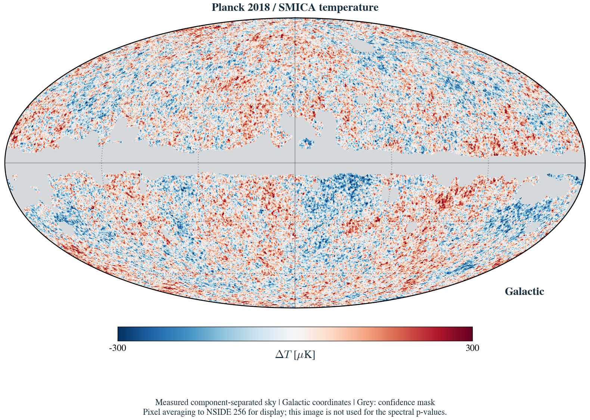

### The scientific question

Planck's familiar all-sky image maps tiny temperature fluctuations in the cosmic microwave background. Some of its largest angular patterns have prompted persistent questions. This project asks whether low quadrupole power, weak large-angle correlations, odd/even imbalance, and low variance provide distinct evidence, or partly reflect the same modes of one observed sky.

### Finding and scope

Conditioning on C2 changes the spectral S1/2 probability from 0.0752 to 0.4842. A separate matched map experiment measures cut-sky correlation and directional variance. A primordial-suppression fit gives search-calibrated p = 0.265. These experiments quantify anomalies and model performance without establishing new physics.

Authorship: Biswajit Jana. Literature retrieval, coding and drafting assisted by OpenAI Codex. Observations: ESA and the Planck Collaboration; distribution: NASA/IPAC IRSA.

## 01 / What is actually measured?

The CMB is a nearly uniform thermal radiation field. Its anisotropies carry contributions from intrinsic photon perturbations, gravitational redshift, velocities, and propagation effects. A hot pixel is not a unique measurement of an overdensity; interpretation requires a cosmological transfer model.

### Data products

We use official PR3 unbinned TT power-spectrum estimates (R3.01), the published best-fit TTTEEE + lowl + lowE + lensing theory, and the PR3 SMICA I_STOKES map with its temperature confidence mask. The spectrum and map experiments use distinct estimators. These are processed scientific products, not a new reduction of raw detector time streams. [1-4]

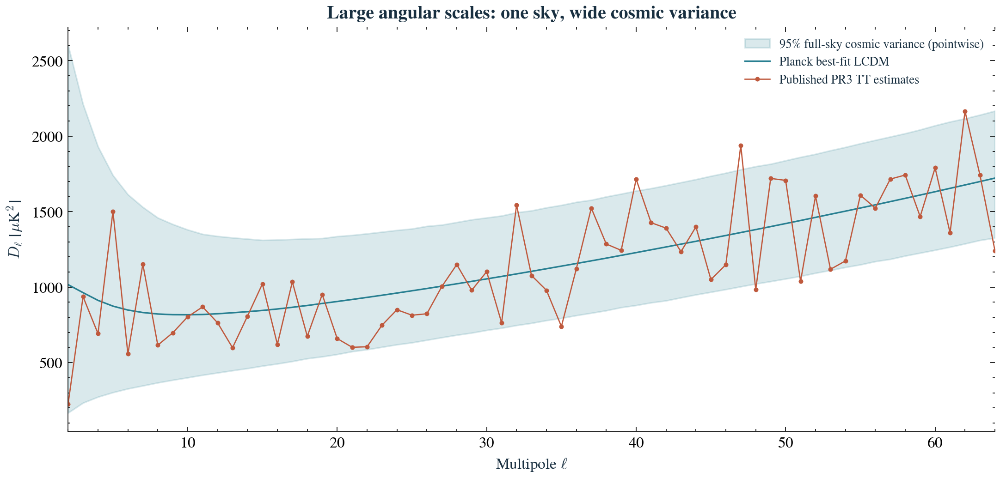

### Why the comparison is approximate

The archive point estimates encode foreground cleaning and likelihood choices. Our simulated spectra instead follow an ideal full-sky, noise-free Gaussian distribution. We do not propagate the published spectrum estimator's joint sampling covariance or refit the cosmology. The results are therefore diagnostic reference probabilities. They must not be substituted for Planck's official anomaly significances.

All input URLs, sizes and SHA-256 fingerprints are stored in data/manifest.json. Small spectrum files are versioned; the large FITS map is downloaded on demand. PR3 is used for a stable reproducible starting point, while the literature review includes NPIPE/PR4 work. [11, 12]

## 02 / The mathematical experiment

Represent the temperature field in spherical harmonics. At each multipole ell, C-ell is the average squared harmonic amplitude. The archive supplies D-ell = ell(ell+1) C-ell / (2 pi), so the code explicitly converts to C-ell.

$$
T(\hat n)=\sum_{\ell m}a_{\ell m}Y_{\ell m}(\hat n),\qquad \widehat C_\ell=\frac{1}{2\ell+1}\sum_m|a_{\ell m}|^2
$$

### A Gaussian isotropic null

For a real, noiseless full sky, (2 ell + 1) times measured C-ell divided by theoretical C-ell follows a chi-square distribution with 2 ell + 1 degrees of freedom. Its variance is 2 C-ell squared / (2 ell + 1). This permits exact power-spectrum simulation without generating a pixel map for every realization.

$$
\frac{(2\ell+1)\widehat C_\ell}{C_\ell}\sim\chi^2_{2\ell+1},\qquad {\rm Var}(\widehat C_\ell)=\frac{2C_\ell^2}{2\ell+1}
$$

| Question | Statistic and fixed choice |
| --- | --- |
| Low quadrupole | C2; lower tail; checked against an exact chi-square CDF |
| Weak correlation | S1/2 = integral from -1 to 1/2 of C(x)^2 dx; ell 2-64 |
| Odd/even imbalance | Mean even D-ell / mean odd D-ell; ell 2-29 |
| Low variance | Sum of (2 ell+1) C-ell / (4 pi); ell 2-29 |
| Independent clues? | Conditioning, tail co-occurrence and calibrated minimum-p |

Correlation is reconstructed as C(x) = sum [(2 ell+1) C-ell P-ell(x)] / (4 pi), where x = cos(theta). Its square-integral is a quadratic form C-transpose K C. Gauss-Legendre quadrature with L+1 nodes integrates the degree-2L polynomial exactly up to roundoff. Full equations and derivations are in docs/methods.md.

$$
S_{1/2}=\int_{-1}^{1/2} C(x)^2\,dx=\mathbf{C}^{\mathsf{T}}K\mathbf{C}
$$

We draw 100,000 reference spectra and 100,000 independent calibration spectra, using separate seed streams from 20261031. A lower-tail probability is estimated as (k+1)/(N+1). Exact binomial intervals report only Monte Carlo counting uncertainty.

The protocol is retrospective and motivated by the literature. It is not a preregistered search. The quadrupole, correlation and parity statistics have extensive prior art. [5-9]

## 03 / Results from the published spectrum

| Statistic | Measured | Lower-tail p | 95% MC interval |
| --- | --- | --- | --- |
| C2 [microK^2] | 236.5567 | 0.04699 | 0.04568 - 0.04831 |
| S1/2 [microK^4] | 6767.5315 | 0.07521 | 0.07357 - 0.07685 |
| Parity ratio | 0.7629 | 0.01011 | 0.00949 - 0.01074 |
| Variance [microK^2] | 2074.5227 | 0.10353 | 0.10164 - 0.10542 |

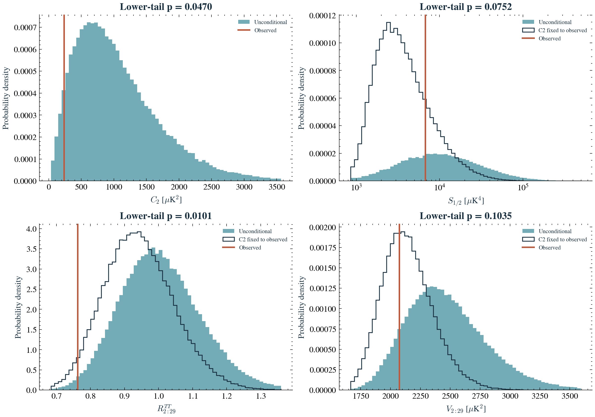

The exact quadrupole lower-tail probability is 0.04686, agreeing with Monte Carlo. The parity ratio is the strongest of the four fixed diagnostics. A p-value is a probability of a statistic under a specified null, not the probability that the null theory is true.

These are not the northern-hemisphere variance or the phase-dependent alignment statistics used in some combined-anomaly papers. Our result cannot validate or refute those combined claims. [14, 15]

## 04 / How much does the quadrupole explain?

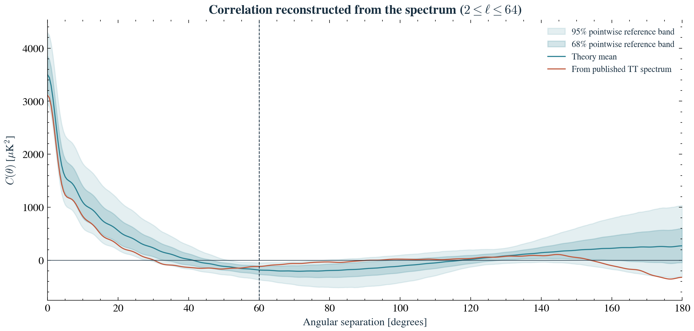

### The conditional question

Keep every calibration realization's multipoles above ell=2, but replace its quadrupole by the published observed value. In the ideal Gaussian model, distinct multipoles are independent, so this samples a well-defined conditional ensemble. It asks how unusual the remaining structure looks once C2 is known.

| Statistic | Unconditional p | C2 fixed p |
| --- | --- | --- |
| S1/2 [microK^4] | 0.07521 | 0.48423 |
| Parity ratio | 0.01011 | 0.02989 |
| Variance [microK^2] | 0.10353 | 0.40245 |

The correlation statistic and variance lose much of their rarity in this conditional experiment. Parity retains a lower-tail preference. This supports shared information in the spectrum-based tests; it does not show that all map anomalies are dependent, and does not explain why C2 is small.

### Estimator dependence matters

Full-sky reconstructed correlations and cut-sky correlations are different observables. Prior work finds materially different probabilities for these estimators. Sections 09-11 now measure a finite-band cut-sky estimator from SMICA and calibrate it with matched Gaussian maps. Its mask, projection and smoothing remain distinct from official Planck analyses. [5-7]

## 05 / Paying for the searches we perform

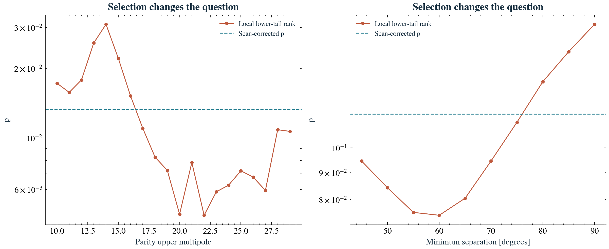

| Declared family | Calibrated minimum-p probability |
| --- | --- |
| Four fixed statistics | 0.03792 |
| Parity cutoff: every integer 10-29 | 0.01327 |
| Angular thresholds: 45-90 deg in 5 deg steps | 0.11577 |
| Four fixed tests plus both scans | 0.03013 |

The reference ensemble defines marginal ranks. Each independent calibration spectrum undergoes the same complete search. The calibration therefore retains dependence among neighboring cutoffs and among the different statistics.

A larger family can produce a smaller corrected result when it also finds a more extreme observed minimum. Corrections should be compared with the minimum of their own family. No multiplication of nominal p-values or assumption of independent diagnostics is needed.

This addresses the declared finite searches, not the unknown historical selection of interesting CMB statistics. It does not settle the 2026 disagreement about combined anomaly significance. Conditioning, cutoff-sensitivity checks and counterfactual diagnostics are exploratory follow-ups, not additional claimed detections. [14, 15]

## 06 / A concrete cancellation diagnostic

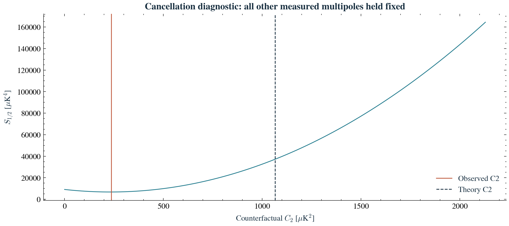

Because S = C-transpose K C, its derivative with respect to C2 is twice the quadrupole component of K C. Setting this derivative to zero gives an exact conditional minimum, subject to C2 being nonnegative.

For the chosen spectrum and bandlimit, the observed C2 is 236.56 microkelvin squared and the minimizing value is 231.75. The theory mean is 1064.72. Their proximity is a post-result observation with no calibrated significance; measurement uncertainty in C2 is much larger than their difference. It is not a new-physics or fine-tuning claim.

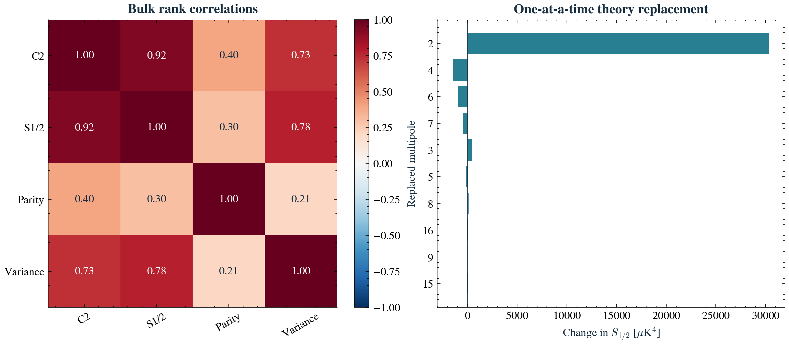

The useful next question is whether a prespecified cancellation diagnostic retains information after propagating map uncertainty and conditioning on both quadrupole and variance. This proposal has unverified novelty; covariance and conditioning already have substantial prior art. [5]

## 07 / Physics beyond the first experiment

A physical explanation must predict more than a small number. A primordial-power modification changes C-ell through a transfer integral: C-ell = 4 pi integral d ln k P_R(k) Delta_T,ell(k)^2. A viable model must also predict TE and EE and survive parameter-fitting penalties. Directly suppressing selected C-ell values is only a toy model.

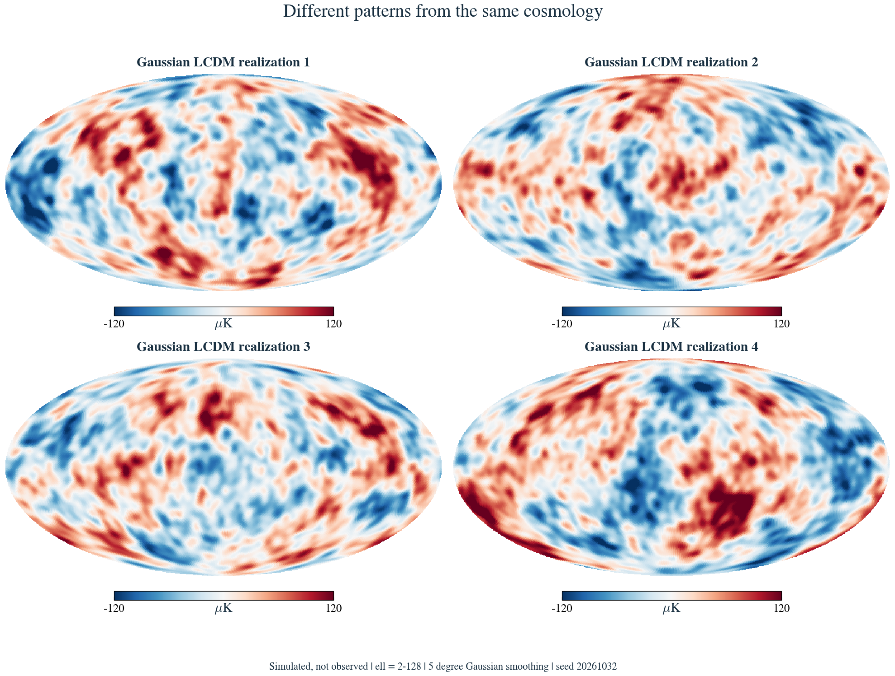

| Candidate explanation | Necessary discrimination |
| --- | --- |
| A chance realization | Matched estimator and mask simulations |
| Primordial power modification | Joint TT/TE/EE predictions from transfer physics |
| Foregrounds or processing residuals | Frequency, mask and cleaning-pipeline tests |
| Topology or anisotropic covariance | Phase-sensitive tests with orientation penalties |

A 2024 PR4 study found the modeled local thermal and kinetic Sunyaev-Zeldovich contributions too small to explain the tested anomalies. This does not exclude every foreground mechanism. Other proposals, including causal-coherence interpretations, remain candidates requiring discriminating tests. [12, 13]

## 08 / Interpretation and validation

### The live scientific disagreement

Jones and collaborators emphasize rare joint tails of four map-based anomaly classes and argue that the anomalies deserve a physical explanation. Guth and Namjoo challenge the significance assigned after test selection and the identification of spectrum anomalies with anisotropy. Their papers motivate explicit search calibration here. Our smaller spectral experiment does not adjudicate their full dispute. [14, 15]

### Validation actually performed

The 18 numerical tests cover units, independent integration, cosmic-variance moments, exact quadrupole probabilities, parity, tail calibration, batch consistency, the cancellation derivative, nuisance projection, explicit pixel-pair powers, dense covariance, primordial limits, likelihood algebra and conditional EE. Production runs record seeds, hashes and software versions. Independent checks use 100,000 additional spectra and 2,048 additional maps.

### Material limits

The spectral null omits mask coupling; the new map null explicitly includes the selected mask and projection. Both omit foreground/noise realizations and cosmological-parameter uncertainty. Conditioning uses an exact plug-in C2 estimate. A spectral power deficit alone does not imply a preferred direction. Binomial intervals are not a complete uncertainty budget. Different instruments observe the same cosmic sample.

### Completed extensions

The following sections report an executed map-and-mask experiment, analytic variance closure, a calibrated hemisphere-direction search, processing sensitivity, and a primordial model propagated through CAMB. Noise/foreground end-to-end simulations and an observed polarization likelihood remain outside this defined study; the polarization curves are explicit model predictions.

### Reproduce the run

Install the package with the dev and report extras, run scripts/download_data.py, run pytest, then run cmb-lab. Rebuild this document with scripts/build_report.py. Use the maps extra and render_planck_map.py for the measured-sky figure. README.md contains complete commands, and requirements-lock.txt records the executed environment.

Repository: https://github.com/Biswajit1999/cmb-anomaly-lab

## 09 / From native pixels to a matched experiment

We verify the original 2.01 GB SMICA FITS file against its recorded SHA-256 hash. Its nested pixels are converted to ring ordering. Harmonics through ell=128 are extracted at native NSIDE=2048 before smoothing or resolution reduction. Temperature is converted from K_CMB to microkelvin.

$$
a^{\rm out}_{\ell m}=a^{\rm in}_{\ell m}\frac{b^{\rm out}_\ell p^{\rm out}_\ell}{b^{\rm in}_\ell p^{\rm in}_\ell},\qquad b_\ell=e^{-\ell(\ell+1)\sigma_b^2/2}
$$

We adopt the 5 arcmin Gaussian SMICA temperature beam and HEALPix pixel windows. The baseline analysis uses a 5 degree output beam and NSIDE=32; native mask fractions must be at least 0.95. A full-sky low-order subtraction followed by the cut-sky fit removes arbitrary monopole and dipole. The second operation is applied identically to every simulation. Smoothing can spread residual foregrounds beyond the mask, which this CMB-only null does not model.

$$
\mathbf{r}=P\mathbf{t},\qquad P=I-X(X^{\mathsf{T}}X)^{-1}X^{\mathsf{T}},\qquad X=(1,n_x,n_y,n_z)
$$

Here t and X contain only retained pixels. P is an orthogonal projection; masking inserts zero outside that sky after fitting. The Gaussian simulations have independent real m=0 modes and complex m>0 modes with the correct variance. Every sky receives the output beam, pixel window, mask and projection.

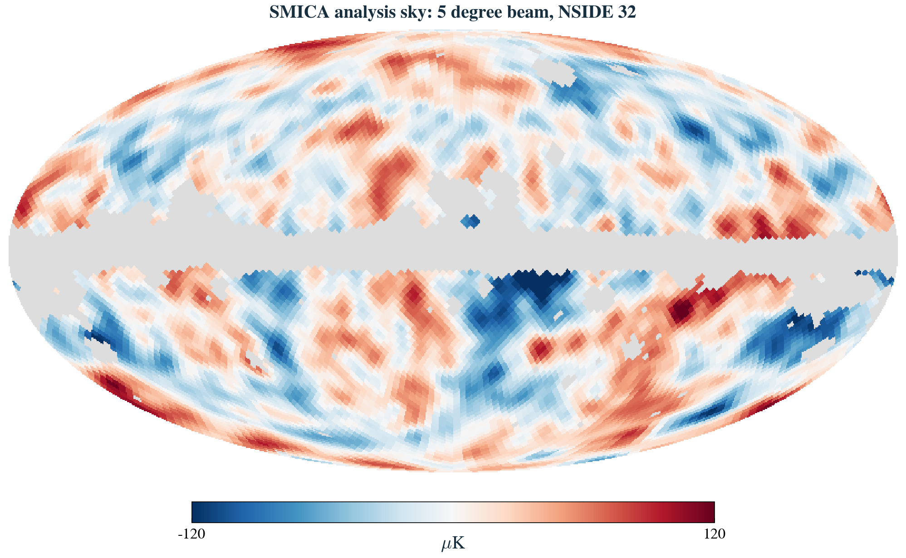

Reference maps: 4,096. Independent calibration maps: 4,096. Baseline retained sky: 81.18%. Each map is analysed under three declared processing variants.

## 10 / The cut-sky correlation measurement

$$
\widehat C_W(x)=\frac{\sum_{\ell=0}^{L}(2\ell+1)\widetilde C_\ell P_\ell(x)}{\sum_{\ell=0}^{L}(2\ell+1)W_\ell P_\ell(x)},\qquad S^W_{1/2}=\int_{-1}^{1/2}\widehat C_W(x)^2 dx
$$

The numerator is the pseudo-spectrum of masked, projected temperatures; W-ell is the spectrum of the binary mask. We use L=95 and 192 Gauss-Legendre nodes. This is a finite-band pair-normalized correlation estimator. A hard mask creates higher harmonics, so it is not an exact all-pairs estimator at infinite resolution. No pseudo-spectrum is identified with an unbiased full-sky spectrum.

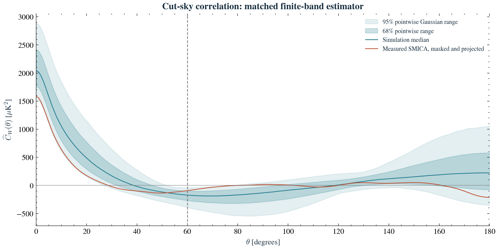

| Diagnostic | Measured | Tail p | 95% MC interval |
| --- | --- | --- | --- |
| Cut-sky S1/2 [microK^4] | 2037 | 0.00805 | 0.00535 - 0.01101 |
| Masked variance [microK^2] | 1591 | 0.04369 | 0.03742 - 0.05016 |
| Masked pseudo-parity | 0.7624 | 0.01855 | 0.01443 - 0.02290 |
| Maximum hemisphere contrast | 0.3108 | 0.08055 | 0.07218 - 0.08907 |

The first three tails are lower; the hemisphere-contrast tail is upper. These probabilities describe the defined CMB-only null. Foreground residuals, instrument noise and cleaning uncertainty are not integrated out.

## 11 / Direction searches, robustness and closure

$$
A_{\max}=\max_{\hat d\in\mathcal{D}}\frac{|V_+(\hat d)-V_-(\hat d)|}{V_+(\hat d)+V_-(\hat d)}
$$

D contains 24 unoriented HEALPix axes. Each hemisphere variance is computed about its own mean after the global cut-sky projection. Every simulated map repeats all directions before taking the maximum. The reported p therefore pays for this finite direction search. It does not cover every possible local-disc or multipole selection.

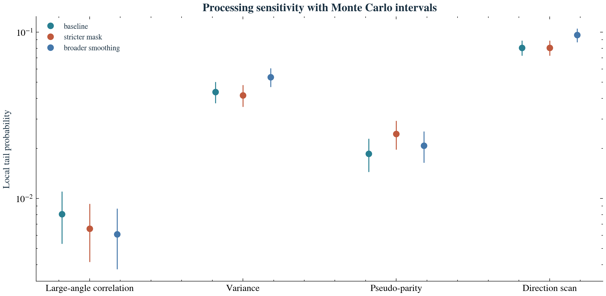

The baseline four-diagnostic family gives p = 0.03149; the twelve columns spanning all three variants give p = 0.03100. These are within-experiment calibrations, not a single global correction for the entire research project.

$$
\langle V_W\rangle=C(0)-\frac{1}{N_W}{\rm tr}\!\left[(X^{\mathsf{T}}X)^{-1}X^{\mathsf{T}}\Sigma X\right]
$$

The analytic projected-variance mean is 2087.658 microkelvin squared; simulations give 2089.582, a difference of 0.36 Monte Carlo standard errors. Doubling integration nodes changes measured S by 4.5e-13 fractionally. Independent tests also compare harmonic powers to explicit pixel pairs and the variance formula to a dense covariance matrix.

An independent 2,048-map seed reproduces the four local tails within 0.76 combined Monte Carlo standard deviations. Changing correlation L=95 to 64 changes measured S by 0.0085%; refining quadrature pixels to NSIDE=64 at fixed smoothed sky and mask footprint changes it by 0.166%.

## 12 / A primordial hypothesis with transfer physics

We test a nonnegative long-wavelength suppression family. It describes a possible primordial power shape; it is not derived here from a specific inflationary potential. Low-power primordial mechanisms have a long literature, so this ansatz is not presented as a new discovery. [17, 18]

$$
\mathcal{P}_{\mathcal{R}}(k)=A_s\left(\frac{k}{k_*}\right)^{n_s-1}\left[1-Ae^{-(k/k_c)^2}\right],\qquad 0\leq A\leq1
$$

$$
C_\ell^{XY}=4\pi\int d\ln k\;\mathcal{P}_{\mathcal{R}}(k)\Delta_\ell^X(k)\Delta_\ell^Y(k),\qquad X,Y\in\{T,E\}
$$

CAMB computes linear scalar transfer functions at a fixed near-Planck background cosmology. We propagate the modified primordial spectrum through TT, TE and EE. Unlensed scalar spectra depend linearly on primordial power, allowing exact amplitude interpolation within this transfer calculation. The fit uses the published TT point estimates over ell=2-29.

| Quantity | Fixed value or search |
| --- | --- |
| H0; physical baryon/CDM densities | 67.36 km/s/Mpc; 0.02237; 0.12000 |
| tau; ns; As | 0.0544; 0.9649; 2.10e-9 |
| Neutrinos; curvature | 0.06 eV; spatially flat |
| Amplitude A | 0 to 1 in steps of 0.1 |
| Cutoff kc | 16 log-spaced values: 3e-5 to 8e-4 Mpc^-1 |

The computed baseline TT differs from the official best-fit TT by at most 0.49% over the fit range. This quantifies the distinction between our fixed background/unlensed calculation and the archived best fit. We do not silently treat them as identical.

## 13 / Does the alternative earn its extra freedom?

$$
2\Delta\ln\mathcal{L}=\sum_\ell(2\ell+1)\left[\ln\frac{C^0_\ell}{C_\ell}+\widehat C_\ell\left(\frac{1}{C^0_\ell}-\frac{1}{C_\ell}\right)\right]
$$

This likelihood expression is exact for ideal full-sky Gaussian temperature powers. On published Planck point estimates it is a likelihood proxy. We maximize it over all 161 distinct models, including the null, and repeat the same fit on 100,000 baseline simulated spectra. Monte Carlo calibration handles the amplitude boundary and unidentified cutoff at zero amplitude without assuming a chi-square likelihood-ratio law.

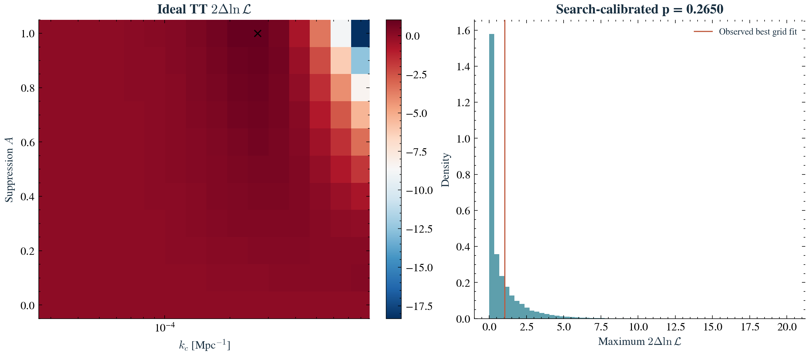

The grid optimum is A = 1.00, kc = 0.000268 Mpc^-1. Its improvement is only 2 Delta ln L = 1.026; the calibrated probability is 0.2650 (95% MC interval 0.2623-0.2677). This experiment provides no compelling preference for this suppression model.

Doubling CAMB accuracy changes the fitted model's improvement by 0.000398 and TT power by at most 0.078%. The amplitude optimum lies at the grid boundary; it is not a parameter measurement or confidence interval. The calculation is not Bayesian evidence and does not refit background parameters.

## 14 / Polarization as a discriminating prediction

$$
a^E_{\ell m}\mid a^T_{\ell m}\sim\mathcal{N}\!\left(\frac{C_\ell^{TE}}{C_\ell^{TT}}a^T_{\ell m},\ C_\ell^{EE}-\frac{(C_\ell^{TE})^2}{C_\ell^{TT}}\right)
$$

The expression is understood for the independent real harmonic degrees of freedom. Temperature and E-mode polarization are correlated, so a polarization prediction conditioned on the observed temperature is more appropriate than pretending that TT and EE are independent tests.

$$
\mathbb{E}[\widehat C_\ell^{EE}\mid\widehat C_\ell^{TT}]=C_\ell^{EE}-\frac{(C_\ell^{TE})^2}{C_\ell^{TT}}+\left(\frac{C_\ell^{TE}}{C_\ell^{TT}}\right)^2\widehat C_\ell^{TT}
$$

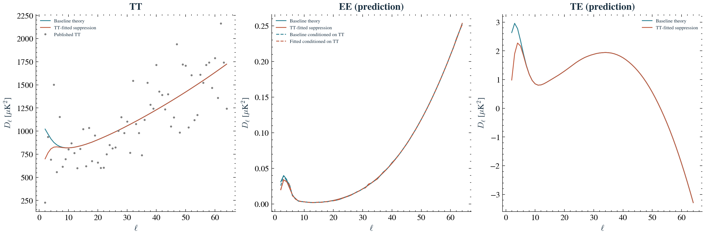

A model that merely reduces TT must also accept the TE and EE consequences of the same primordial spectrum. The CSV export supplies both unconditional and temperature-conditioned EE predictions. An observational polarization test requires masks, correlated noise and foreground uncertainties, which are not contained in these theoretical curves.

### Scientific conclusion

The completed study demonstrates estimator-dependent large-angle rarity, shared low-multipole information, and a weak fit gain for one explicit primordial alternative. It establishes reproducible numerical results under stated models. It does not establish a physical origin for the anomalies or resolve the full cosmological debate. Independent review and realistic observational likelihoods are required for stronger conclusions.

## References and research provenance

A focused reading guide with reading-depth labels, caveats and primary-source links is provided in docs/literature-review.md. The following references anchor this report; inclusion is not endorsement of every interpretation.

1. [Planck Collaboration. Planck 2018 results VII: Isotropy and Statistics (2020)](https://arxiv.org/abs/1906.02552)

2. [Planck Collaboration. Planck 2018 results V: Power spectra and likelihoods (2020)](https://arxiv.org/abs/1907.12875)

3. [Planck Collaboration. Planck 2018 results IV: Diffuse component separation (2020)](https://arxiv.org/abs/1807.06208)

4. [Planck Collaboration. Planck 2018 results VI: Cosmological parameters (2020)](https://arxiv.org/abs/1807.06209)

5. [Muir, Adhikari and Huterer. Covariance of CMB anomalies (2018)](https://arxiv.org/abs/1806.02354)

6. [Efstathiou, Ma and Hanson. Large-Angle Correlations (2010)](https://arxiv.org/abs/0911.5399)

7. [Copi et al. Lack of large-angle TT correlations persists (2015)](https://arxiv.org/abs/1310.3831)

8. [Schwarz et al. CMB Anomalies after Planck (2016)](https://arxiv.org/abs/1510.07929)

9. [Copi et al. Large-angle anomalies in the CMB (2010)](https://arxiv.org/abs/1004.5602)

10. [Copi et al. Large-scale alignments from WMAP and Planck (2015)](https://arxiv.org/abs/1311.4562)

11. [Planck Collaboration. Intermediate results LVII: NPIPE (2020)](https://arxiv.org/abs/2007.04997)

12. [Jung et al. Revisiting large-scale anomalies: local SZ contributions (2024)](https://arxiv.org/abs/2406.11543)

13. [Hogan et al. Dipole-independent nearly-zero CMB correlation (2025)](https://arxiv.org/abs/2312.16147v7)

14. [Jones et al. Strong Evidence Against a Statistically Isotropic Universe (2026 revision)](https://arxiv.org/abs/2310.12859v3)

15. [Guth and Namjoo. Statistical isotropy and the look-elsewhere effect (2026)](https://arxiv.org/abs/2602.10178v2)

16. [Gorski et al. HEALPix (2005)](https://arxiv.org/abs/astro-ph/0409513)

17. [Lewis, Challinor and Lasenby. Efficient computation of CMB anisotropies / CAMB (2000)](https://arxiv.org/abs/astro-ph/9911177)

18. [Contaldi et al. Suppressing the lower multipoles in the CMB anisotropies (2003)](https://arxiv.org/abs/astro-ph/0303636)

19. [Hivon et al. MASTER of the CMB anisotropy power spectrum (2002)](https://arxiv.org/abs/astro-ph/0105302)

20. [Probing foreground residuals in cleaned CMB temperature maps from Planck (2025)](https://link.springer.com/article/10.1140/epjc/s10052-025-15246-y)

Data: NASA/IPAC IRSA Planck PR3 ancillary products and CMB maps. Credit ESA and the Planck Collaboration. Some visualization results use healpy and HEALPix. Original software and prose: MIT license, copyright 2026 Biswajit Jana. Third-party data retain their source terms.
