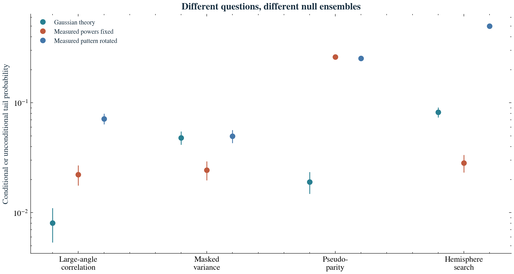
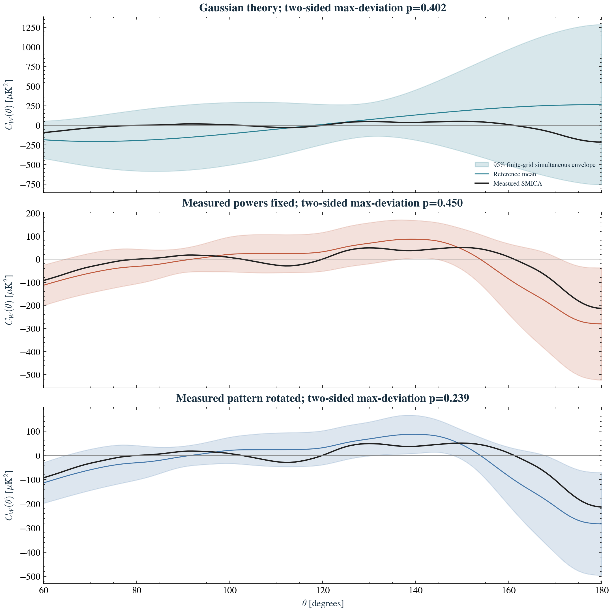
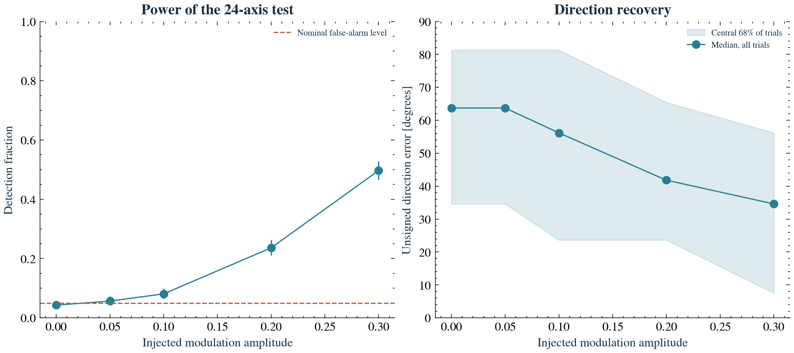

# Conditional morphology and orientation experiments

Author: Biswajit Jana

Exploratory CMB-only randomization diagnostics. The fixed powers and rotated pattern come from a processed full-sky component-separated map, including uncertain foreground regions. Smoothing before masking can mix these regions into retained pixels. Neither conditional ensemble removes this systematic uncertainty or constitutes an independent observation.

| Ensemble | S lower tail | Variance lower tail | Pseudo-parity lower tail | Hemisphere upper tail | Four-test family |
|---|---:|---:|---:|---:|---:|
| Gaussian theory | 0.00805 | 0.04808 | 0.01904 | 0.08201 | 0.03564 |
| Measured powers fixed | 0.02221 | 0.02441 | 0.26117 | 0.02831 | 0.07444 |
| Measured pattern rotated | 0.07152 | 0.04979 | 0.25384 | 0.49817 | 0.13791 |

These are three different null hypotheses; their p-values are not multiplied, pooled, or combined with earlier studies. Counting intervals, independent validation and analytic closure are in [results.json](results.json).

Per ensemble: 1024 reference, 4096 calibration and 1024 held-out validation skies. Three ensembles total 18,432 realizations.

Detection power of a toy dipole modulation applied AFTER 5-degree smoothing; not an inferred primordial amplitude. Each row uses the same underlying skies, so rates across amplitudes are correlated. The maximizing axis is unsigned and searched over 24 directions.

| Injected A | Detection rate | 95% counting interval | Median unsigned axis error |
|---|---:|---|---:|
| 0.00 | 0.0430 | 0.0314 - 0.0573 | 63.7 deg |
| 0.05 | 0.0566 | 0.0433 - 0.0726 | 63.7 deg |
| 0.10 | 0.0811 | 0.0651 - 0.0995 | 56.2 deg |
| 0.20 | 0.2363 | 0.2106 - 0.2636 | 41.8 deg |
| 0.30 | 0.4971 | 0.4660 - 0.5282 | 34.6 deg |
